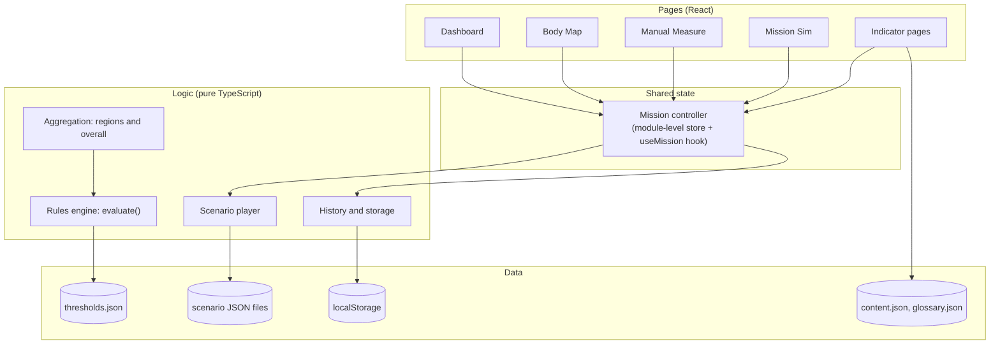
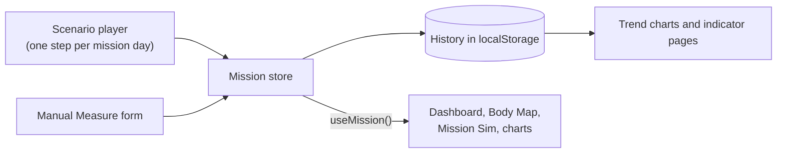

# OrbitWell: Wellness in every orbit

**Health monitoring software for astronauts on long space missions.**
Built by **Dream Team UA** for the [NASA Space Apps Challenge 2026](https://www.spaceappschallenge.org/2026/), challenge *"Create Health Monitoring Software for Astronauts on Space Missions"*.

- **Live demo:** https://nasa-challenge-dream-team-ua-2026.vercel.app

> **Disclaimer.** OrbitWell is an educational prototype. All data is synthetic, reference ranges are indicative, and nothing in the app is medical advice or a medical device.

---

## Table of contents

1. [Overview](#overview)
2. [How we address the challenge](#how-we-address-the-challenge)
3. [Features](#features)
4. [Tracked indicators](#tracked-indicators)
5. [Architecture](#architecture)
6. [Data model](#data-model)
7. [Mission scenarios](#mission-scenarios)
8. [Getting started](#getting-started)
9. [Quality: tests, linting, validation](#quality-tests-linting-validation)
10. [Deployment and offline use](#deployment-and-offline-use)
11. [Sources and credits](#sources-and-credits)
12. [Limitations and roadmap](#limitations-and-roadmap)
13. [Team](#team)

---

## Overview

On missions far from Earth, communication with ground control is delayed and crew members carry much of the responsibility for noticing changes in their own health. Radiation, isolation, altered gravity and a closed environment can affect the heart, sleep, mood, metabolism and immune system.

**OrbitWell** is a web application that lets an astronaut:

- record vital signs (manually or through a simulated mission),
- see at a glance whether each indicator is **normal**, needs **attention** or is **critical**,
- explore the body as an interactive map of systems and organs,
- follow trends over time on dynamic charts,
- learn, in plain language, how to take each measurement, why it matters in space, what to do, and when to contact the flight surgeon, with sources.

The app runs entirely in the browser. There is no backend, so it keeps working offline after the first load, which suits missions with limited connectivity.

## How we address the challenge

| Challenge idea | What OrbitWell does |
|---|---|
| Gather health indicators from the user | Manual Measure form (heart rate, blood pressure, temperature, glucose, sleep, mood, notes) plus a Mission Simulator that streams realistic data |
| Visual tool to assess own health | Dashboard with six live indicator cards, alerts and a mini body model |
| Clickable human figure | Body Map: male/female models, clickable regions, organ panels with linked measurements |
| Color coding at a glance | Normal / Attention / Critical states on cards, pills and body zones, always paired with an icon and text |
| Dynamic charts over time | Trend charts (7 days, 14 days, all) with normal-range reference lines |
| Do not assume astronauts know everything | Per-indicator guidance, glossary tooltips for units and terms, "when to contact the flight surgeon" |
| Hazards of spaceflight | Each indicator explains its link to microgravity, isolation, radiation and the closed environment, with NASA references |
| Different environments and mission routine | Scenario-based simulation of mission days (EVA overload, sleep and circadian disruption, illness) |

## Features

### Dashboard (`/`)
- Six live indicator cards: heart rate, blood pressure, body temperature, blood glucose, sleep, mood and stress.
- Each card shows the current value, unit, normal range and a status pill; clicking it opens the indicator page.
- A system alerts panel lists everything that is not normal, or confirms that all systems are nominal.
- A mini body model highlights affected regions and links to the full Body Map.

### Body Map (`/body`)
- Male and female silhouettes with clickable regions: head, torso, hips, arms, legs.
- Each region lists its organs (brain and neuro, eyes, heart, lungs, liver, digestive system, kidneys, urinary system) with a status computed from the measurements linked to that organ.
- Expanding an organ shows its illustration and the related measurements, each linking to the full indicator page.

### Manual Measure (`/measure`)
- Guided form with units and plausible-range validation.
- Blood pressure, sleep duration and quality, mood slider and a free-text symptoms/activity field.
- Every save is recorded as a **new mission day** (history is appended, never overwritten) and immediately updates the whole site.

### Mission Simulator (`/mission`)
- Choose a mission scenario, then **Start / Pause / Resume / Reset** the simulation.
- Time speed from 0.5x to 10x, mission day counter, progress bar and a live telemetry monitor.
- The simulation keeps running while you browse the rest of the site: the Dashboard, Body Map and charts show the state of the current mission day.
- Playback position is saved, so after a page reload the simulation resumes on pause at the same day.

### Indicator pages (`/indicator/:id`)
- Unit, normal range and a trend chart (systolic and diastolic lines for blood pressure).
- Structured guidance: **How to Measure**, **Why It Matters**, **Space Risk**, **When to Worry**, **What to Do**, **When to Contact the Flight Surgeon**, **Sources**.
- Glossary tooltips explain terms such as bpm, mmHg and mg/dL inline.

### Across the app
- Responsive layout with a slide-in mobile menu (swipe gestures).
- Installable PWA with offline support.
- Space-themed interface using Exo 2, Inter, Michroma and Roboto Condensed.
- First-run seed data: 30 days of nominal telemetry so charts are never empty.

## Tracked indicators

| Indicator | Metrics | Unit | Normal range | Body system |
|---|---|---|---|---|
| Heart rate | `heart_rate` | bpm | 60-100 | Cardiovascular |
| Blood pressure | `bp_systolic`, `bp_diastolic` | mmHg | 90-119 / 60-79 | Cardiovascular |
| Body temperature | `body_temperature` | °C | 36.1-37.2 | Immune |
| Blood glucose | `blood_glucose` | mg/dL | 70-99 | Metabolism |
| Sleep | `sleep_hours` | hours | 7-10 | Brain and mind |
| Mood | `mood_score` | 1-5 | 3-5 | Brain and mind |

Each metric has three states, `normal`, `attention` and `critical`, defined by zones in [`src/content/thresholds.json`](src/content/thresholds.json). The "Bones and muscles" system exists in the model for future indicators and currently reports "no data".

## Architecture

OrbitWell is a client-side single-page app (React + TypeScript + Vite) in four layers. The logic layer is plain TypeScript with no React dependency, which makes it easy to test and to reuse.



### Data flow



- Both the simulation and manual entries write **only** to the mission store, and every page subscribes to it through the `useMission()` hook (React `useSyncExternalStore`).
- The store lives at module level, so the simulation timer is not tied to any page: you can leave `/mission`, inspect the Body Map or an indicator page, and return, and the simulation keeps going.
- History, current vitals and the playback position are persisted in `localStorage`, so a reload restores the same day (paused).

### Project structure

```
.
├─ index.html                 App shell, fonts, PWA icons
├─ vite.config.ts             Vite, PWA manifest and Workbox caching, Vitest config
├─ public/                    Body silhouettes (male/female), organ illustrations, PWA icons
└─ src/
   ├─ main.tsx                Entry: dev-time data validation, first-run seed, render
   ├─ App.tsx                 Router, Dashboard, layout
   ├─ index.css               Theme and component styles
   ├─ pages/
   │  ├─ BodyMapPage.tsx      Interactive body model and organ panels
   │  ├─ MeasurePage.tsx      Manual measurement form
   │  ├─ MissionPage.tsx      Scenario player UI and live telemetry monitor
   │  └─ IndicatorPage.tsx    Per-indicator guidance, chart, sources
   ├─ components/
   │  ├─ Navbar.tsx           Header, mission day, desktop/mobile navigation
   │  ├─ TrendChart.tsx       Recharts line chart with normal-range reference lines
   │  └─ GlossaryText.tsx     Tooltip glossary for units and terms
   ├─ core/                   Framework-free logic
   │  ├─ types.ts             Shared types (metrics, indicators, regions, scenarios, results)
   │  ├─ indicators.ts        Indicator to metric to body-region mapping
   │  ├─ zones.ts             Zone lookup
   │  ├─ evaluate.ts          Rules engine
   │  ├─ aggregate.ts         Region and overall status helpers
   │  ├─ storage.ts           Measurement persistence (localStorage with in-memory fallback)
   │  ├─ history.ts           Mission-day numbering and per-metric series for charts
   │  ├─ measurements.ts      Measurement factory and scenario expansion
   │  ├─ missionControler.ts  Shared store, playback control, useMission hook
   │  ├─ validate.ts          Consistency checks for threshold and content data
   │  ├─ data.ts              Typed access to the JSON data
   │  └─ evaluate.test.ts     Unit tests
   ├─ data/
   │  ├─ player.ts            Scenario player (timer-driven, pausable, restorable)
   │  ├─ seed.ts              First-run seed data
   │  └─ scenarios/           Mission scenarios as JSON (auto-discovered)
   └─ content/
      ├─ thresholds.json      Zones per metric
      ├─ content.json         Guidance texts and sources per indicator
      └─ glossary.json        Term definitions for tooltips
```

### Rules engine

`evaluate(measurements, profile)` in [`src/core/evaluate.ts`](src/core/evaluate.ts) is a pure function driven entirely by `thresholds.json`:

- **Zones:** each metric has a list of zones sorted by increasing `min`. A value belongs to the last zone whose `min` it reaches; the first zone has no `min` and covers everything below. `max` is informational and used to display ranges such as "normal 60-100". Because of this rule there are no gaps between zones.
- **Indicator status:** the worst status of its metrics (blood pressure is the worse of systolic and diastolic).
- **Plain-language reason:** for example, "Heart rate is 118 bpm, above the normal range (60-100 bpm)."
- **Trend:** the latest value against the average of the previous three days, judged by distance from the normal zone: `improving`, `stable`, `worsening` or `unknown`.
- **Regions and overall:** each body region takes the worst status of its indicators (or `no-data`), and the overall status is the worst of all indicators that have data.

Adding or tuning an indicator is a data change in JSON, not a code change.

### Scenario player

[`src/data/player.ts`](src/data/player.ts) turns a scenario into one batch of measurements per mission day and emits them on a timer (1.5 s per day at 1x). It supports start, pause, resume, reset, speed changes (0.25x-20x) and restoring a saved position. Timestamps are aligned so that the last day of a scenario is "now", which keeps the charts' time axis meaningful.

## Data model

```ts
type Measurement = {
  type: MetricId;        // 'heart_rate' | 'bp_systolic' | 'bp_diastolic' | 'body_temperature'
                         // | 'blood_glucose' | 'sleep_hours' | 'mood_score'
  value: number;
  unit: string;
  timestamp: string;     // ISO 8601
  missionDay?: number;
};

type Status = 'normal' | 'attention' | 'critical';
type Trend = 'improving' | 'stable' | 'worsening' | 'unknown';
```

**`thresholds.json`** holds, for each metric, its unit, the valid input range and ordered zones:

```json
"heart_rate": {
  "indicator": "heart_rate",
  "label": "Heart rate",
  "unit": "bpm",
  "validRange": { "min": 20, "max": 250 },
  "zones": [
    { "status": "critical", "max": 49 },
    { "status": "attention", "min": 50, "max": 59 },
    { "status": "normal", "min": 60, "max": 100 },
    { "status": "attention", "min": 101, "max": 120 },
    { "status": "critical", "min": 121 }
  ]
}
```

**`content.json`** holds the guidance for each indicator: `howToMeasure`, `whyItMatters`, `spaceRisk`, `whenToWorry`, `actions`, `callFlightSurgeon` and a list of `source` links.

**Scenario file** (`src/data/scenarios/*.json`):

```json
{
  "id": "normal",
  "title": "Normal scenario",
  "story": "...",
  "days": [
    { "day": 185, "values": { "heart_rate": 66, "bp_systolic": 112, "bp_diastolic": 72,
                              "body_temperature": 36.6, "blood_glucose": 88,
                              "sleep_hours": 7.4, "mood_score": 4 } }
  ]
}
```

**Browser storage keys:** `ahm.measurements.v1` (history), `orbitwell_vitals` (current state), `orbitwell_mission_v1` (playback position) and `ahm.seeded.v1` (seed flag).

## Mission scenarios

Each scenario is a 30-day mission segment (mission days 185-214).

| Scenario | What it shows |
|---|---|
| Normal | Baseline: all indicators within range |
| EVA Overload | Physical and cardiovascular strain after intensive extravehicular activity |
| Hypoglycemia and Fever | Metabolic and immune stress with abnormal glucose and temperature |
| Sleep deprivation | Progressive loss of sleep and its effect on mood and heart rate |
| Circadian rhythm deprivation | Disrupted sleep-wake cycle |

**Add a scenario:** drop a JSON file with the structure above into `src/data/scenarios/`. Files are discovered automatically and appear on the Mission Sim page.

## Getting started

**Requirements:** Node.js 20.19+ (or 22.12+) and npm.

```bash
git clone https://github.com/Zapash0k/NASA-Challenge-Dream-Team-UA-2026.git
cd NASA-Challenge-Dream-Team-UA-2026
npm install
npm run dev        # http://localhost:5173
```

| Script | Purpose |
|---|---|
| `npm run dev` | Start the development server |
| `npm run build` | Type-check and create a production build in `dist/` |
| `npm run preview` | Serve the production build locally |
| `npm test` | Run the unit tests (Vitest) |
| `npm run lint` | Lint with oxlint |
| `npm run format` / `format:check` | Format or check formatting with Prettier |

**Tech stack:** React 19, React Router 7, TypeScript, Vite 8, Recharts 3, vite-plugin-pwa (Workbox), Vitest, oxlint and Prettier.

**Try it in 60 seconds:** open **Mission Sim**, pick *Sleep deprivation* or *EVA Overload*, press **Start** at 5x, then browse the Dashboard, Body Map and an indicator page while the mission runs.

## Quality: tests, linting, validation

- **Unit tests** (`npm test`) cover data validity, zone boundaries, blood-pressure aggregation, latest-value selection, region and overall status, trends, handling of bad input, scenario expansion and storage.
- **Data validation:** in development, `validateData()` checks that every metric has sorted zones with a normal zone and that every indicator has guidance content, and logs problems to the console.
- **Linting and formatting:** oxlint and Prettier configurations are included.
- **Branching:** work happens in feature branches and is merged through pull requests; `main` is always deployable.

## Deployment and offline use

- The app is a static site built with `npm run build` and deployed to **Vercel** from the `main` branch.
- It is a single-page app with client-side routing, so a static host must serve `index.html` for unknown paths.
- As a **PWA** it precaches the app shell and assets and caches Google Fonts at runtime, so after the first visit it works offline. All data stays in the browser.

## Sources and credits

Guidance and reference ranges are based on public sources:

- NASA Human Research Roadmap, cardiovascular adaptations: https://humanresearchroadmap.nasa.gov/Risks/risk.aspx?i=179
- NASA Cardiovascular and Vision Laboratory: https://www.nasa.gov/directorates/esdmd/hhp/cardiovascular-and-vision/
- NASA Immunology and Virology: https://www.nasa.gov/directorates/esdmd/hhp/immunology-and-virology/
- NASA, how long-term spaceflight alters immunity: https://www.nasa.gov/missions/station/scientists-probe-how-long-term-spaceflight-alters-immunity/
- NASA Behavioral Health and Performance: https://www.nasa.gov/reference/jsc-behavioral-health/
- NASA, behavioral issues associated with long-duration space missions: https://humanresearchroadmap.nasa.gov/tasks/task.aspx?i=752
- NASA Technical Report, insulin secretion and sensitivity in space flight: https://ntrs.nasa.gov/citations/20040088078
- American Heart Association, target heart rates: https://www.heart.org/en/healthy-living/fitness/fitness-basics/target-heart-rates
- American Heart Association, understanding blood pressure readings: https://www.heart.org/en/health-topics/high-blood-pressure/understanding-blood-pressure-readings
- American Diabetes Association, diagnosis: https://diabetes.org/about-diabetes/diagnosis
- MedlinePlus, fever: https://medlineplus.gov/fever.html

Built with open-source software: React, React Router, Recharts, Vite, Vitest and vite-plugin-pwa. Fonts (Exo 2, Inter, Michroma, Roboto Condensed) are served by Google Fonts.

This project is not affiliated with or endorsed by NASA.


## Limitations and roadmap

**Current limitations**
- All data is synthetic and stored in the browser only; there is no backend or multi-user sync.
- Reference ranges are indicative, based on general adult ranges and public sources, and have not been reviewed by a flight surgeon.
- The personal-baseline parameter of `evaluate()` is reserved but not used yet, and trends are computed in the core but not yet shown in the UI.
- Status logic is shared through `thresholds.json`, but some pages still use local helper functions; unifying all pages on `evaluate()` is planned.

**Roadmap**
- Drive every page from the shared rules engine, including region and overall status.
- Personal baselines and trend alerts (for example, sleep below 6 hours for several days).
- An auto-generated report for the flight surgeon that accounts for communication delay.
- Environment profiles (station, spacecraft, lunar or Martian base) with different risk weights.
- Gamification for regular health routines (streaks and mission tasks).
- Optional measurement via camera (photoplethysmography) and import from wearables or CSV.
- Indicators for bones and muscles, radiation exposure and CO₂ levels.

## Team

**Dream Team UA**

| Member | Role |
|---|---|
| @Pueblo51 | Tech lead: core logic, rules engine, integration, deployment |
| @Havi-Dorgeir | Interactive body map and visual interaction |
| @yourlady2345 (Discord) | Design, presentation and pitch |
| @CreperWin | Science content, thresholds and scenarios |
| @sashkopodilchuk2000-creator | Frontend: layout, pages, charts |
